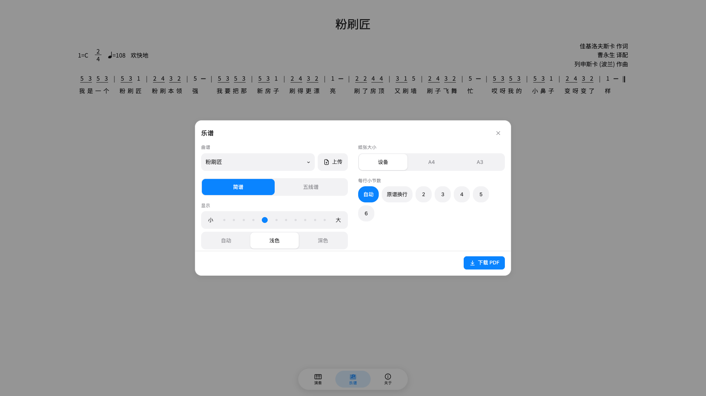
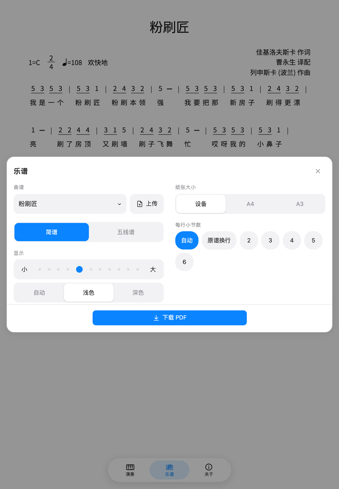
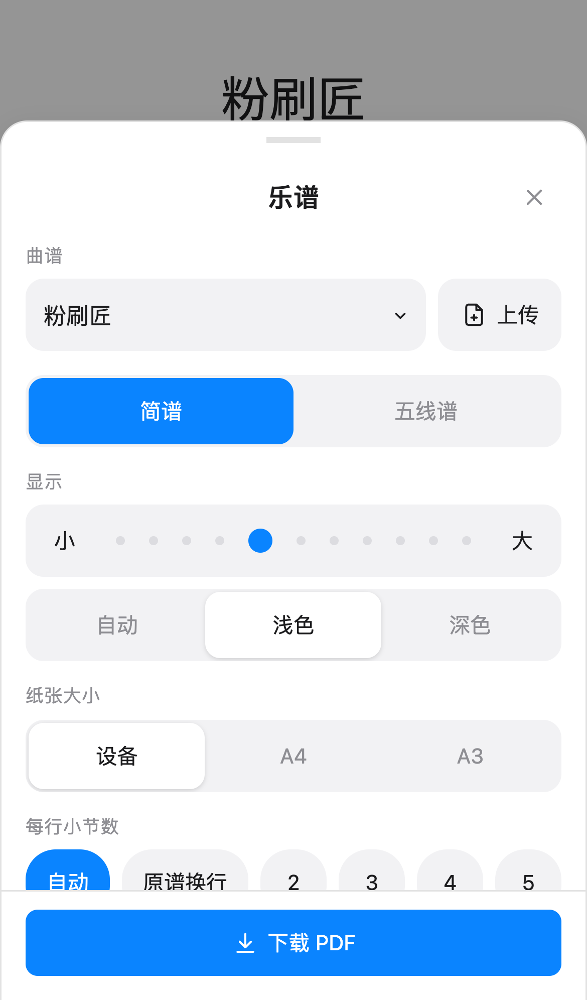
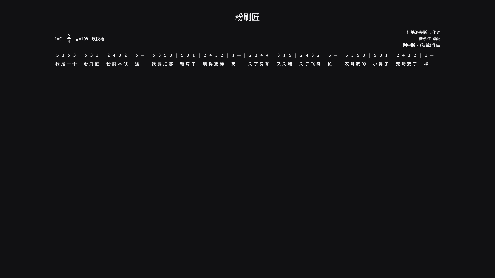
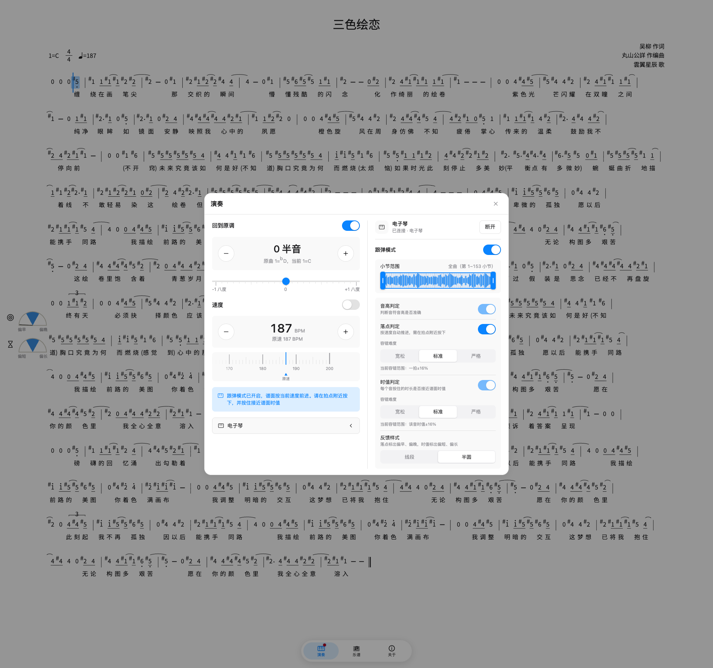
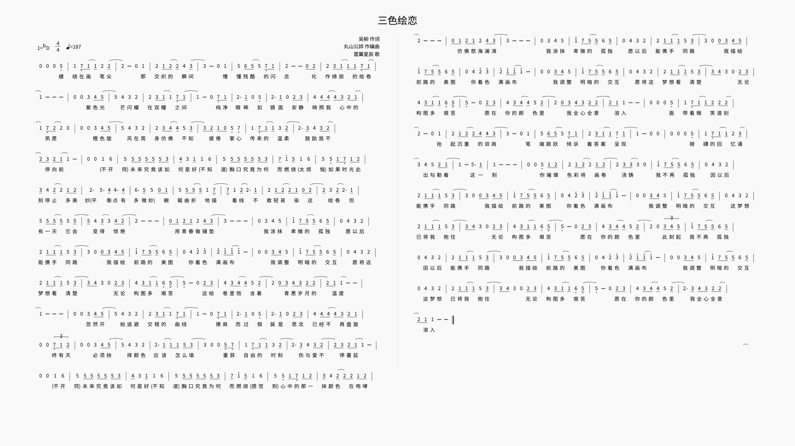

# xml2jianpu

**易谱**把 [MusicXML](https://www.w3.org/2021/06/musicxml40/) 转成简谱或五线谱。打开就能看谱、试听，也可以导出 PDF。

- 网页：<https://sunbeamhub.github.io/xml2jianpu/>
- 安装包：<https://github.com/sunbeamhub/xml2jianpu/releases>

## 打开

### 网页

用 Chrome、Edge、Firefox 或 Safari 打开上面的地址。iOS 11 及以上，iPadOS 13 及以上（更早的 iPad 用 iOS 11 及以上也可以），macOS 10.12 及以上。Android 建议 8 及以上。Internet Explorer 打不开。

### 安装到本机

在网页里把易谱装到手机或电脑，用单独窗口打开。

- **Chrome / Edge**（电脑或 Android）：地址栏或菜单里选「安装应用」。
- **Safari**（iPhone / iPad）：分享 → 添加到主屏幕。

第一次打开要联网，用来保存界面、字体和内置示例。之后断网也能打开、切换内置示例、用「电子」音色试听，并导出 PDF。钢琴音色第一次使用仍要联网。自己上传的曲谱不会被保存，刷新或关掉后要重新选择。

### 下载安装包

到 [GitHub Releases](https://github.com/sunbeamhub/xml2jianpu/releases) 下载对应系统的文件。

| 平台 | 文件 | 说明 |
| --- | --- | --- |
| Windows 10+ | `yipu_{version}_windows_x64.msi` 或 `.exe` | 装到当前用户 |
| macOS | `yipu_{version}_macos_aarch64.dmg`（Apple 芯片）、`yipu_{version}_macos_x86_64.dmg`（Intel） | 按芯片选择 |
| Linux | `.deb` / `.rpm` / AppImage（`yipu_{version}_linux_{arch}`） | 近两年常见的发行版 |
| Android | `yipu_{version}_android_aarch64.apk` | 系统 7 及以上，仅 arm64 |
| iOS | `yipu_{version}_ios_aarch64.ipa` | 系统 14 及以上；日常使用请打开网页，见下 |

从 GitHub 下载的 macOS 安装包，第一次打开可能提示「已损坏」。在终端执行下面的命令，再重新打开：

```bash
xattr -cr /Applications/易谱.app
```

芯片要选对：Apple 芯片用 `aarch64`，Intel 用 `x86_64`。选错也会打不开。

iOS 安装包只能装到事先登记过的设备上，大约 7 天后失效。请用 Safari 打开网页，或添加到主屏幕。

## 能做什么

屏幕底部有「演奏」「乐谱」「关于」。「关于」里可以看版本和更新。

### 乐谱

点「乐谱」可以换曲、上传、切换简谱或五线谱、调字号与主题外观、选纸张和换行，并导出 PDF。手机是从底部拉上来的面板，更宽的屏幕是对话框。







主题可以选「现代」或「锤子」，外观可以选浅色、深色，或跟随系统。下次打开会沿用上次的选择。




- **换曲**：网页里的示例按专辑分组，点一下就能看。
- **上传**：选择本地 `.musicxml` 或 `.xml`。网页里只在这次打开有效。安装包会把文件存进「易谱」文件夹。
- **纸张**：默认「设备」，按当前屏幕宽度排。也可以改成 A4 或 A3 看打印效果。导出 PDF 要用 A4 或 A3；还停在「设备」时，会提示先改纸张。
- **换行**：可以自动按纸宽估算、沿用原谱的换行，或固定每行 2 到 6 小节。
- **字号**：从 12 到 22，调节唱名和歌词的大小。点「小」「大」、拖动圆点或按方向键时，档位立刻变，谱面在停一下后再重绘。

字号、换行、主题、移调和纸张，在简谱和五线谱里都会尽量沿用。试听时，简谱会标出当前这一拍，五线谱会显示光标。

### 演奏

点「演奏」可以移调、调速度和试听。已经离开原调，或速度已经改过时，「演奏」右上角会出现红点。

打开后唱名改成 `1=C`，方便按 C 调演奏。可以按半音升高或降低，上下各一个八度，也可以随时回到原调。速度范围是 20 到 200。移调、速度的点按、拖动、长按、方向键和回到原调、原速，都是弹窗里的数字立刻变，谱面停一下后再更新。试听可以在「电子」和「钢琴」之间切换。

这些调整只在当前这次打开里有效。换一首，或刷新页面后，会回到原谱。导出的 PDF 用的是移调之后的谱，谱上的速度数字也会按当前速度变化。



在支持的浏览器里，或在安装包中，可以连接 USB 电子琴，并打开跟弹。声音从琴自己的音源出来。网页要使用 https，或在本机打开。Safari 打开的网页默认没有这项功能。跟弹时，谱面停在当前该弹的音，按对后进入下一个音；也可以检查按住多久、落在哪一拍，松紧可以调节。打开落点判定时，时值判定会一起打开，不能单独关掉。

落点判定倒计时结束后，简谱和五线谱上会有一条竖线按拍往前走。这一轮里弹错的音会留成红色，包括音没按对、没落在拍点附近、按住的时间不对，或该弹的时候没弹。一轮结束后会再倒计时，红色和竖线都回到这一轮的起点。

跟弹时可以拖一条小节范围，只在选中的小节里循环。拖动时会吸到小节线上，旁边标出当前是第几小节。改了范围会马上重新倒计时。换一首后，范围回到整首。

### 看谱

电脑会按窗口大小自动分成多列，最多 4 列，尽量让长谱落在一屏里。平板和手机保持单列。



屏幕放得下时，右侧会显示整首的缩略图。点一下，或上下拖动，就能跳到对应位置。放不下时改为缩放：电脑用 Ctrl 或 Cmd 加滚轮，手机和平板用双指捏合。纸张是「设备」、换行又是自动时，同样只提供缩放。

### 谱面上有什么

谱的开头会显示调号（`1=`）、拍号、速度、表情，以及作词、译配和作曲。简谱把唱名和歌词对齐，并画出高低点、升降号、附点、延音线、连线、休止符和小节线。

### 下次还会记住

会记住当前曲目、简谱或五线谱、纸张、换行、字号、主题、外观，以及跟弹相关的开关。也会记住上次选中的电子琴，下次连上后还会选它。移调、速度、播放进度和跟弹的起止小节不保存。

### 乐谱文件夹（仅安装包）

安装包把曲谱放在文档目录的「易谱」文件夹里，曲目列表就是这个文件夹。每次打开会补上还没有的内置示例，已有的同名文件保持原样。上传时可以选一个子文件夹再保存，同名文件会被换成新的。网页和「安装到本机」不用这个文件夹。

## 开发

需要 **Node.js 20+**。克隆后执行 `npm install`。

发版标签必须是 `vX.Y.Z`，并且和 [package.json](package.json)、[src-tauri/tauri.conf.json](src-tauri/tauri.conf.json)、[src-tauri/Cargo.toml](src-tauri/Cargo.toml) 里的版本相同，还要高于已有标签。[CHANGELOG.md](CHANGELOG.md) 里要有对应的 `## [x.y.z]`。推送这种标签时，会按标签上的那一次提交做检查。

### 技术栈

- 界面：Vue 3，用 Vite 6 构建
- 曲谱：简谱自己排版，五线谱用 OpenSheetMusicDisplay，试听用 Tone.js
- 导出：矢量 PDF
- 客户端：[Tauri 2](https://v2.tauri.app/)，同一套界面打出 Windows、macOS、Linux、Android 和 iOS
- 网页可以安装到本机，并在断网后继续使用

### 本地运行

**网页**

```bash
npm install
npm run dev
```

打开 [http://localhost:5173/](http://localhost:5173/)。`npm run build` 的结果在 `dist/`。

**桌面（Windows / macOS / Linux）**

先安装 [Tauri 前置依赖](https://v2.tauri.app/start/prerequisites/)：Node.js 20+ 和 Rust。Linux 还需要系统库。Debian / Ubuntu 可以这样装：

```bash
sudo apt update
sudo apt install libwebkit2gtk-4.1-dev libasound2-dev build-essential curl wget file \
  libxdo-dev libssl-dev libayatana-appindicator3-dev librsvg2-dev
```

```bash
npm run tauri:dev
```

第一次运行，或清过缓存之后，改用 `npm run tauri:dev:warm`。

**Android**

安装 Android Studio、SDK 和 NDK，并设置 `JAVA_HOME`（建议 JDK 17）、`ANDROID_HOME`、`NDK_HOME`。`tauri android init` 生成的 `src-tauri/gen/` 要提交到 Git。构建产物和签名密钥不要提交。

```bash
npm run tauri android init -- --ci   # 仅第一次
npm run icon:all                     # 会更新桌面图标，不改 iOS 图标
npm run tauri:android:dev
```

上面的开发模式在较旧的 Android 上可能打不开。旧机器请安装正式包：

```bash
./scripts/setup-android-signing.sh   # 在本机生成签名，不会提交到 Git
npm run tauri:android:build
```

安装包在 `src-tauri/gen/android/app/build/outputs/apk/universal/release/`，文件名是 `yipu_{version}_android_aarch64.apk`。

**iOS**

只能在 macOS 上开发，需要 Xcode 和 CocoaPods。把 [.env.example](.env.example) 复制成 `.env`，填上 `APPLE_DEVELOPMENT_TEAM`。最低系统是 iOS 14（与 `src-tauri/gen/apple/project.yml` 一致）。`tauri ios init` 生成的 `src-tauri/gen/apple/` 也要提交。

```bash
npm run tauri:ios:dev
```

本地打出的安装包只能装到登记过的设备上，大约 7 天后失效。装好后，到设备的「设置 → 通用 → VPN 与设备管理」里信任开发者。失效后，用 Xcode 再连一次这台设备即可。

### 发版

先把改动写进 `CHANGELOG.md` 的 `[Unreleased]`，再升版本、打标签并推送：

```bash
npm run version:bump -- 0.0.2
git add -A && git commit -m "chore: 发布 0.0.2"
git tag v0.0.2
git push origin tauri v0.0.2
```

标签推错时，删掉后再推一个新的：`npm run tag:revoke -- 0.0.2`。

推送 `vX.Y.Z` 会更新网页，并构建各平台安装包，挂到同一条草稿发布。草稿要在 GitHub 网页上手动发布，别人才能下载。「关于」里的更新检查也只看已经发布的版本。桌面和 Android 的「立即更新」会打开安装包，需要自己安装。

Fork 之后，如果仓库名不是 `xml2jianpu`，要改 `npm run build:pages` 使用的路径。要发布自己的安装包时，还要改应用标识 `com.sunbeamhub.xml2jianpu`。

### 部署

**GitHub Pages**

1. Settings → Pages：Source 选 **GitHub Actions**。
2. Settings → Environments → **github-pages**：允许标签 `v*.*.*`。建议也允许分支 `tauri`，方便手动运行。
3. 构建时使用子路径 `/xml2jianpu/`。
4. 地址：<https://sunbeamhub.github.io/xml2jianpu/>

**腾讯云 EdgeOne**

供开发者在大陆查看构建结果，访问地址以控制台给出的域名为准。打开 [EdgeOne Makers 控制台](https://console.cloud.tencent.com/edgeone/pages)，连接这个仓库，Production 分支选 `tauri`。构建方式写在 [edgeone.json](edgeone.json) 里。它只跟随 `tauri` 分支，不跟随版本标签。

**桌面**

同一条版本标签会构建 Windows、macOS 和 Linux 安装包。macOS 包没有做系统签名，第一次打开的处理见上文。

**Android**

仓库 Secrets 里要有 `ANDROID_KEY_BASE64`、`ANDROID_KEY_ALIAS`、`ANDROID_KEY_PASSWORD`，否则安装包无法装到真机。产物只有 arm64。

**iOS**

发布出去的安装包和本地包一样，只能装到登记过的设备上，大约 7 天后失效。这些 Secrets 不要把证书文件提交进仓库：

- `APPLE_DEVELOPMENT_TEAM`：10 位 Team ID，和本机 `.env` 里相同
- `IOS_CERTIFICATE`：开发证书 `.p12` 的 Base64
- `IOS_CERTIFICATE_PASSWORD`：导出证书时设的密码
- `IOS_MOBILE_PROVISION`：描述文件的 Base64

`npm run version:bump` 会先看本机描述文件有没有过期。过期了会停下来，提醒用 Xcode 连一次真机后再执行；还有效的话，会把新内容放到剪贴板，用来更新 `IOS_MOBILE_PROVISION`。证书和密码仍要自己更新。描述文件不更新，自动构建就做不出能安装的包。
